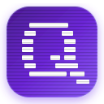

<div align="center">

  

  <h1><code>qInstall</code></h1>

  <p>
    <b>Instalador por lotes 100% portable para Pendrives USB y Discos Externos en Windows 10 / 11</b><br />
    <sub>Alternativa moderna, visual y online/offline a Ninite · Pensada para post-formateo, soporte técnico y despliegue rápido</sub>
  </p>

  <p>
    
    
    
    
  </p>

  <p>
    &nbsp;
    &nbsp;
    &nbsp;
    &nbsp;
    &nbsp;
    &nbsp;
    &nbsp;
    &nbsp;
    &nbsp;
    &nbsp;
    &nbsp;
    &nbsp;
    &nbsp;
    &nbsp;
    &nbsp;
    
  </p>

</div>

---

## ✨ ¿Qué hace diferente a `qInstall`?

> [!IMPORTANT]
> **`qInstall` no es un programa fijo que se instala en la PC:** está diseñado exclusivamente para ejecutarse desde tu **pendrive USB o disco duro externo**, gestionando todo desde su propia interfaz gráfica sin scripts `.bat` externos ni archivos `.log` basura.

| Pilar | Cómo funciona |
| :--- | :--- |
| 💾 **Panel `Almacenamiento` integrado** | Copia `qInstall` limpio a cualquier pendrive o disco externo en 1 clic desde la cabecera, revisa el espacio libre en vivo y borra instaladores descargados uno por uno. |
| 🎒 **Perfiles portables (`profiles.json`)** | Tus perfiles de **Esenciales** (*Estándar, Gamer, Dev, Técnico, Oficina* o tu lista personalizada), tu tema y tu vista preferida viajan guardados en el USB junto a `Qinstall.exe`. |
| 🎨 **Interfaz WebView2 100% Offline** | **Modo Oscuro**, **Modo Claro** y **Sistema** sincronizado con la barra nativa de Windows, **125 íconos locales** (`< 500 KB`), **3 vistas** (*Galería*, *Cuadrícula*, *Tabla*) y barra **Nyan Cat** fluida a `60 fps`. |
| ⚡ **Híbrido Online + `DESCARGADO`** | Instala al vuelo la última versión vía **Winget / Microsoft Store / URL**, o pulsa **Descargar offline** para llevar los instaladores en `local\cache\` y usarlos en PCs **sin Internet**. |
| 🛡️ **Detección en vivo (cero logs)** | Escanea en tiempo real el Registro (`HKLM`/`HKCU`), `winget list`, Office Click-to-Run y DirectX para marcar lo que ya está `INSTALADO` y permitir **Desinstalar** con clic derecho o **Actualizar** todo el sistema. |
| 🪟 **Respaldo nativo automático** | Si abres el pendrive en un Windows recién instalado sin *WebView2 Runtime*, `qInstall` abre automáticamente su interfaz clásica nativa WinForms (`MainForm`). |

---

## 📏 Requisitos del Sistema y Reglas de Espacio

> [!WARNING]
> **Capacidad mínima obligatoria en el pendrive: `2 GB`** (tanto de tamaño total como de espacio libre). Si intentas instalar o copiar `qInstall` en una memoria menor a **2 GB**, el programa **bloqueará la operación automáticamente**. Se recomiendan **`4 GB o más`** (`16 GB+` si deseas llevar varios instaladores descargados offline).

- **Sistema Operativo:** Windows 10 (`1809+`) o Windows 11 (`64-bit`), ejecutado con permisos UAC de Administrador (solicitados automáticamente).
- **Sin dependencias externas:** Compilado sobre `.NET Framework 4.8` (incluido de fábrica en Windows 10/11) + librerías `WebView2` embebidas. Si el equipo no trae `Winget`, aparece un botón en la cabecera para instalarlo en un clic.
- **Restricción automática de suites gigantes en pendrive:** Programas que ocuparían varios gigabytes en caché local (*Microsoft Office 2016–2024, Visual Studio 2022, Android Studio, Docker Desktop, ComfyUI, LM Studio* e *IDEs pesados de JetBrains*) están **restringidos a instalación online** para proteger el espacio del USB (para Office viaja únicamente el lanzador ligero `office\setup.exe` de `~3.5 MB`).
- **Control de versiones obsoletas (`ACTUALIZAR`):** Cuando conectas tu pendrive en una PC con Internet, `qInstall` comprueba en paralelo (`4×` más rápido) si salió una versión más reciente de tus instaladores guardados en `local\cache\` y te pide **purgar o reemplazar** los antiguos para garantizar buen funcionamiento.

---

## 📦 Catálogo Incluido (`176 Apps` · `14 Categorías`)

### 🌐 Navegadores & 💬 Comunicación
| Categoría | Aplicaciones destacadas |
| :--- | :--- |
| **Navegadores** |  Google Chrome ·  Mozilla Firefox ·  Brave ·  Opera GX |
| **Comunicación** |  Discord ·  WhatsApp *(MS Store)* ·  Telegram Desktop ·  Zoom Workplace |

### 🛠️ Técnico, Drivers, Reparación & Optimización
| Categoría | Aplicaciones destacadas |
| :--- | :--- |
| **Soporte y Drivers** |  Punto de Restauración ·  NVCleanstall *(todas las familias NVIDIA)* ·  NVIDIA App & PhysX ·  AMD Auto-Detect *(Radeon + Chipset)* ·  Intel DSA ·  Snappy Driver Installer Origin *(SDIO)* ·  DDU ·  HWiNFO64 ·  GPU-Z ·  MSI Afterburner ·  Malwarebytes ·  AnyDesk ·  TeamViewer ·  Parsec ·  Bitwarden ·  KeePassXC |
| **Utilidades** |  7-Zip ·  WinRAR ·  Everything ·  PowerToys ·  Rufus ·  CrystalDiskInfo ·  CPU-Z ·  NZXT CAM ·  WizTree ·  TreeSize ·  qBittorrent ·  uTorrent ·  Instalar/Reparar Microsoft Store |
| **Optimización** |  Chris Titus WinUtil ·  ReviOS *(AME + Playbook)* ·  O&O ShutUp10++ ·  Winaero Tweaker ·  BleachBit ·  BCUninstaller ·  Revo Uninstaller ·  Autoruns ·  Process Lasso ·  Windhawk |
| **Arranque y Reparación** |  Ventoy ·  DiskGenius ·  TestDisk ·  AOMEI Partition ·  MiniTool Partition ·  EFI Boot Editor · PartBoot ·  DISM + SFC ·  Respaldo BCD |

### 🤖 IA, 💻 IDEs, JetBrains & Desarrollo
| Categoría | Aplicaciones destacadas |
| :--- | :--- |
| **IA y Agentes** |  ChatGPT & Codex CLI ·  Claude Desktop & Claude Code ·  Google Gemini & Gemini CLI ·  Google Antigravity / IDE / CLI ·  OpenCode Desktop & CLI ·  GitHub Copilot & CLI ·  Cursor ·  Windsurf ·  Trae ·  Perplexity Comet ·  Grammarly ·  Otter.ai ·  Ollama ·  LM Studio ·  Jan AI ·  Cherry Studio ·  ComfyUI |
| **IDEs y JetBrains** |  JetBrains Toolbox ·  IntelliJ IDEA *(Pro & Community)* ·  PyCharm *(Pro & Community)* ·  WebStorm ·  CLion ·  Rider ·  PhpStorm ·  DataGrip ·  GoLand ·  RustRover ·  Visual Studio 2022 ·  Android Studio ·  Eclipse *(Java & C/C++)* ·  NetBeans ·  VSCodium ·  Sublime Text 4 ·  Zed ·  Neovim ·  Dev-C++ `5.9.2` & Embarcadero `6.3` ·  Code::Blocks ·  Arduino IDE 2 ·  Godot ·  Unity Hub |
| **Desarrollo** |  VS Code ·  GitHub Desktop ·  Git ·  Notepad++ ·  Windows Terminal ·  Python 3.12 ·  Node.js LTS ·  Postman ·  DBeaver ·  Docker Desktop |

### 📄 Oficina, 🎬 Multimedia, 🎮 Juegos, ⚙️ Runtimes & ☕ Java
| Categoría | Aplicaciones destacadas |
| :--- | :--- |
| **Oficina** |  Microsoft Office `2024` / `2021` / `2019` / `2016` *(ODT)* ·  LibreOffice ·  SumatraPDF ·  Acrobat Reader ·  PDFgear *(alternativa Acrobat Pro)* ·  Obsidian ·  Google Drive |
| **Multimedia** |  VLC ·  Spotify ·  OBS Studio ·  ShareX ·  HandBrake ·  Kdenlive ·  Shotcut ·  CapCut ·  Adobe Creative Cloud ·  GIMP ·  Paint.NET ·  Inkscape *(Illustrator)* ·  Krita *(Photoshop)* ·  Blender *(3D/VFX)* ·  Darktable *(Lightroom)* ·  Scribus *(InDesign)* |
| **Juegos** |  Steam ·  Epic Games Launcher |
| **Runtimes** |  Visual C++ AIO *(2005–2022)* + paquetes `x64`/`x86` individuales ·  DirectX Runtime ·  .NET Desktop Runtime `6` / `8` / `9` / `10` / `11` ·  XNA 4.0 · OpenAL ·  WebView2 Runtime |
| **Java** |  Java 8 *(Oracle JRE)* ·  Eclipse Temurin JRE & JDK `11` / `17` / `21` LTS ·  Oracle JDK `25` LTS |

---

## 🤫 Parámetros Silenciosos Explicados

> [!TIP]
> Con **Instalación silenciosa** activada, los programas se instalan solos en segundo plano sin pantallas de *«Siguiente → Acepto → Instalar»*. En apps de **Winget** (`--silent`) y en **instaladores descargados offline** (`.yaml` automático) `qInstall` lo configura solo.

Cuando agregas un instalador propio con **`+ Local`**, puedes elegir una plantilla rápida según el fabricante:

| Tipo de instalador | Parámetro recomendado | Ejemplo común |
| :--- | :--- | :--- |
| **NSIS** | `/S` | 7-Zip, VLC, Notepad++, Dev-C++ |
| **Inno Setup** | `/VERYSILENT /NORESTART` | Utilidades e instaladores independientes |
| **Windows Installer (`.msi`)** | `/qn /norestart` | *Automático si lo dejas en blanco* |
| **Microsoft / WiX / Burn** | `/quiet /norestart` | Runtimes e instaladores oficiales |
| **Instalación guiada normal** | *(Dejar vacío)* | Abre el asistente habitual del programa |

---

## ⌨️ Atajos y Controles Rápidos

- <kbd>/</kbd> — Enfocar instantáneamente la barra de búsqueda (catálogo local + Winget online).
- <kbd>Enter</kbd> *(en el buscador)* — Lanzar búsqueda directa en el repositorio online de Winget.
- <kbd>Esc</kbd> — Limpiar búsqueda o cerrar cualquier menú / ventana modal abierta.
- **Clic derecho sobre una app** — **Desinstalar** *(si ya está instalada)*, **Borrar descargado** *(si está en `local\cache\`)* o **Quitar del catálogo**.

---

## 🚀 Cómo llevarlo en tu Pendrive o Disco Externo

1. Abre **`Qinstall.exe`**.
2. Pulsa arriba a la derecha en **`Almacenamiento`**.
3. En **Copiar qInstall a Otra Unidad**, elige tu pendrive USB o disco externo (mínimo **2 GB**, recomendado **4 GB+**) y haz clic en **`Copiar a unidad`**.

<details>
<summary><b>📂 Ver estructura portable que se copia en tu unidad</b></summary>

```text
Qinstall/
├── Qinstall.exe                        # Ejecutable principal (x64, UAC Admin, Per-Monitor DPI)
├── Microsoft.Web.WebView2.Core.dll     # Motor WebView2 embebido
├── Microsoft.Web.WebView2.WinForms.dll
├── WebView2Loader.dll
├── apps.json                           # Catálogo editable de 163 aplicaciones
├── profiles.json                       # Tus perfiles y ajustes portables
├── ui/                                 # Interfaz 100% offline + 125 íconos en ui/icons/
├── office/                             # Microsoft Office Deployment Tool (setup.exe + XMLs 2016-2024)
└── local/                              # Tus instaladores .exe/.msi + caché offline (local/cache/)
```

</details>

<details>
<summary><b>🧩 Formato de <code>apps.json</code> y compilación QA (Desarrollo)</b></summary>

### Esquema de una aplicación en `apps.json`
```json
{
  "Id": "7zip",
  "Name": "7-Zip",
  "Category": "Utilidades",
  "Description": "Compresor de archivos ligero y libre",
  "Source": "winget",
  "Target": "7zip.7zip",
  "SilentArgs": "",
  "Essential": true
}
```
- `Source`: `"winget"` (ID Winget o MS Store), `"url"` (enlace `.exe`/`.msi`), `"local"` (ruta relativa al USB) o `"powershell"` (herramienta elevada).

### Verificación QA y actualización automática de `Qinstall.exe`
No requiere instalar Visual Studio ni SDKs externos; usa el compilador C# nativo de `.NET Framework 4.8` incluido en Windows y ejecuta las 14 pruebas automatizadas con:

```powershell
powershell -NoProfile -ExecutionPolicy Bypass -File ".\.agents\skills\thorough-code-testing\scripts\verify_qinstall.ps1" -UpdateExe
```

</details>
